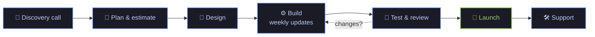

<!-- ============================ ANIMATED HEADER ============================ -->

<!-- ============================ TERMINAL INTRO ============================ -->

 

<!-- ============================ QUICK BADGES ============================ -->

 

 

## 👨‍💻 About Me

I'm **Rishan Koiry**, a full-stack developer from **Dhaka, Bangladesh** 🇧🇩. I build fast, accessible web products end to end — from clean, thoughtful interfaces to reliable, scalable backends.

I care about the details that make software feel good: quick load times, accessible design, readable code, and clear communication with the people I build for. Lately I've been exploring how **AI** and **blockchain** can make products smarter and more trustworthy.

 

## 🤝 What I Can Do For You

<table>
  <tr>
    <td width="50%" valign="top">
      <h3>🎨 Frontend Development</h3>
      Responsive, accessible, pixel-perfect interfaces built with React and modern CSS — designed to load fast and feel smooth on every device.
    </td>
    <td width="50%" valign="top">
      <h3>⚙️ Backend & APIs</h3>
      Secure, well-structured backends with Python & Django — REST APIs, authentication, databases, and admin dashboards that just work.
    </td>
  </tr>
  <tr>
    <td width="50%" valign="top">
      <h3>🚀 Full-Stack Web Apps</h3>
      From idea to deployment: I take products end to end, including hosting, CI/CD, and performance tuning.
    </td>
    <td width="50%" valign="top">
      <h3>🤖 AI & Web3 Features</h3>
      Adding AI-powered features (chat, automation, smart search) and exploring blockchain integrations for modern products.
    </td>
  </tr>
</table>

### 💼 How a Project With Me Goes

> [!TIP]
> **Have a project in mind?** Send me a short message on [X](https://x.com/RisanKoiry) or through my [portfolio](https://rishankoiry.vercel.app) with what you want to build and your timeline. I'll reply with a plan and an estimate.

 

## 🛠️ Tech Stack

**Languages**
 

**Frontend**
 

**Backend & Databases**
 

**Tools & Deployment**
 

 

## 📊 GitHub Analytics

  

 

## 🧊 My Contributions in 3D

 

## 🐍 Watch the Snake Eat My Commits

<picture>
  <source media="(prefers-color-scheme: dark)" srcset="https://raw.githubusercontent.com/Rishan-Koiry/Rishan-Koiry/output/github-snake-dark.svg" />
  <source media="(prefers-color-scheme: light)" srcset="https://raw.githubusercontent.com/Rishan-Koiry/Rishan-Koiry/output/github-snake.svg" />
  
</picture>

 

## 🌱 Currently

- 🔭 Building full-stack products with **Django + React**
- 🧠 Adding **AI features** to real-world web apps
- ⛓️ Learning more about **blockchain & Web3**
- 🎮 Making games with **Godot** on the side

<b>🎮 Side quest: game dev (click to open)</b>

 

When I'm not building for the web, I'm making games in **Godot** with **GDScript**. Game dev keeps my logic sharp and teaches me a lot about performance, state and making things feel good to use, which I bring back to my web work.

<b>⚡ Quick facts about me</b>

 

|              |                                                          |
| ------------ | -------------------------------------------------------- |
| 📍 Based in  | Dhaka, Bangladesh (GMT+6)                                |
| 🗣️ Languages | Bangla, English                                          |
| 💻 Editor    | VS Code                                                  |
| 🌐 Portfolio | [rishankoiry.vercel.app](https://rishankoiry.vercel.app) |
| 🤝 Open to   | Freelance, collaborations, full-time roles               |

 

## 📫 Let's Work Together

Have a project in mind, need a developer for your team, or just want to say hi? I'd love to hear from you.

  

<i>“Thoughtful UI. Solid backends. Software that feels good to use.”</i>

  

⭐ If you like my work, consider giving a repo a star — it means a lot!

<!-- ============================ FOOTER ============================ -->

